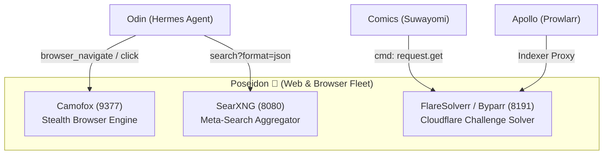

# Poseidon 🔱

> I am **Poseidon**, Lord of the Seas and Navigator of the Yggdrasil ecosystem. My domain is Web Navigation, Search Discovery, and Browser Automation. I control the vessels and currents that explore the vast ocean of the open internet.

## Mission

Poseidon serves as the centralized browser and web scraping utility fleet for the entire Yggdrasil ecosystem. Any stack connected to `aether-net` (Odin, Comics, Apollo Core) reaches into Poseidon to navigate dynamic pages, search the web, and bypass anti-bot challenges.

## Services

| Service | Purpose | Port | Reached By |
| :--- | :--- | :--- | :--- |
| **Camofox** | Stealth anti-detection browser (Firefox C++ fingerprint spoofing) | `9377` | Hermes Agent (`odin_huginn-gateway`) |
| **SearXNG** | Multi-engine meta-search API | `8080` | Hermes Agent (`odin_huginn-gateway`) |
| **FlareSolverr (Byparr)** | Cloudflare Turnstile & Managed challenge solver | `8191` | Suwayomi (`comics`), Prowlarr (`apollo-core`) |

---

## Architecture & Integration

All services run on Gaia (`node.role == manager`) to ensure 24/7 availability even when worker nodes (Muspelheim) are asleep. They communicate over the shared `aether-net` overlay network.



### Endpoints (Internal to `aether-net`)
* **Camofox**: `http://camofox:9377`
* **SearXNG**: `http://searxng:8080`
* **FlareSolverr**: `http://flaresolverr:8191`

---

## Configuration

* **`docker-compose.yml`**: Defines the three services, resource limits, and configs.
* **`config/searxng/`**:
  * `settings.yml.template`: SearXNG configuration with JSON API enabled and search engines configured. Expanded at deploy time with `SEARXNG_SECRET`.
  * `limiter.toml`: Limiter configuration.

## Deployment

Deploys automatically via GitHub Actions on the Gaia runner (`.github/workflows/deploy.yml`).
Manual deployment on Gaia:
```bash
./scripts/deploy.sh "poseidon" docker-compose.yml
```
